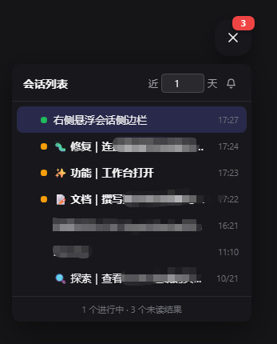
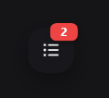

# dsh-session-top-new

A session overview dock for the **DeepSeek Harness Web GUI**: every session's
unread and running state at a glance, with one-click jumping and a completion
chime.





## Features

- **Overview, not per-session** — the dock is a global aggregate: you see the
  state of *all* sessions while you are inside one of them.
- **Live status** — a running session shows a pulsing green dot; a session
  whose result you have not looked at shows an amber dot and a bold title; the
  round button carries a red badge counting unread results.
- **N-day history** — shows sessions updated within the last N days (default:
  today only). N is editable in the panel header, 1–365.
- **Click to jump** — clicking a session switches the main view straight to it.
  The panel stays open.
- **Parent / child grouping** — subagent sessions nest under their parent and
  stay collapsed until you expand them, instead of flattening into one list.
- **Completion chime** — a synthesized two-tone chime (Web Audio, no asset
  files) plays when a session finishes, with a mute toggle.
- **Draggable and resize-aware** — drag the button anywhere; the position is
  stored as a fraction of the window, so it keeps its relative spot when the
  window is resized. The panel flips up or sideways near a screen edge.
- **Dismiss a row** — the ✕ that appears on hover hides that row; it comes back
  by itself once the session produces something newer. Dismissing a parent also
  hides its currently visible subagent rows.
- **Collapsible** — expands by default; click the button to collapse it back to
  a single round button.

## 中文说明

一个 DSH Web GUI 的**会话总览悬浮栏**：跨会话查看未读/运行状态，一键跳转，
会话完成时发出提示音。

- 圆形按钮可**拖拽**到任意位置，窗口缩放时按比例跟随
- 「近 N 天」可自定义（默认当天）
- 运行中显示绿色脉冲点，未查看结果显示琥珀点，按钮红色角标显示未读数
- 子任务折叠在主任务下，不平铺
- 点击会话直接跳转，面板不自动收起
- 鼠标悬停行尾出现 **×**：忽略该记录，等这个会话有新记录时自动重新出现
  （忽略主任务会同时忽略它当前显示的子任务）
- 结束提示音使用 Web Audio 合成，无需音频文件，可静音

## Install

```bash
dsh plugin --profile web add github:cuijiajun/dsh-session-top-new
```

Or from npm (prebuilt, skips the build-approval step):

```bash
dsh plugin --profile web add dsh-session-top-new
```

Then **restart the Web GUI** — the client-modules scan caches package verdicts
per boot, so a newly installed plugin only appears after a restart.

## Layout

```
dsh.plugin.json     plugin manifest (id / version / main / engines)
cordis.patch.yml    bundle patch: mounts the host plugin row
lib/index.js        host entry (no-op; exists so the bundle mounts)
lib/client.js       the dock: __ModuleLoader__ bundle (apply + widget)
assets/             screenshots
screenshots.json    storefront screenshot list
```

## How it works

The widget registers a root-scope `shell.overlay` entry, so it floats above the
whole app regardless of panel or session. It reads two client services and
keeps only the leaf fields it renders:

| Purpose | Source |
| --- | --- |
| Session list and metadata | `sessions.list` — `ids`, `byId[id]` with `displayTitle`, `running`, `updatedAt`, `parentId`, `origin`, `retainedBy.mainView` |
| Running / unread state | `uiSession.sessionStatus` — `{ running, pendingInteraction, completionUnread }` |
| Jump to a session | `uiWorkspace.openSession(id)` |

The `dock` observable subscribes to both sources, extracts a flat snapshot of
scalars, and hands the widget a referentially stable object. A `running →
finished` transition (or a new `completionUnread` flag) triggers the chime,
respecting the mute toggle.

## Compatibility

This plugin talks to the DSH **client runtime services** named above. They are
the interfaces the official UI itself uses, but they are not a frozen public
API, so a Harness upgrade may rename or restructure them. When that happens the
dock can lose its click-to-jump or status markers until the plugin is updated —
if a control stops responding, check the browser console for a
`[dsh-session-top-new]` warning, which is emitted instead of failing silently.

Tested against DSH builds current as of October 2026.

## License

MIT
